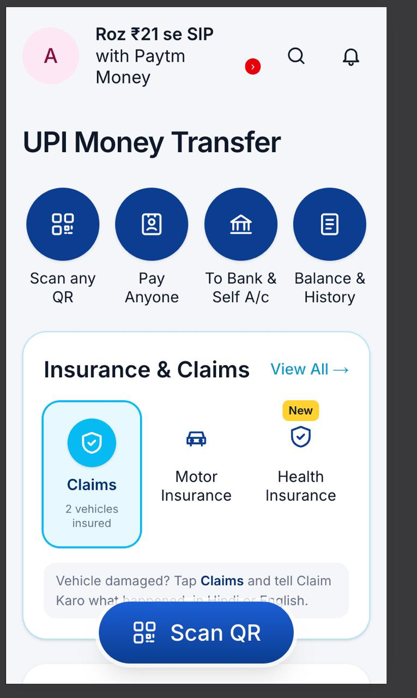
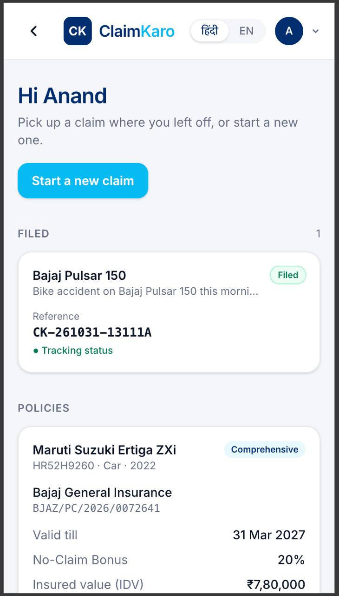
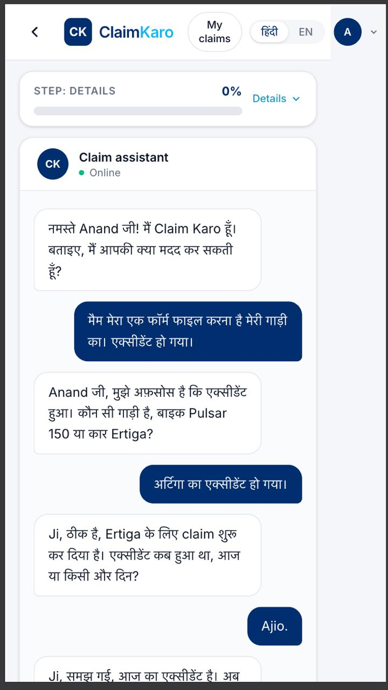
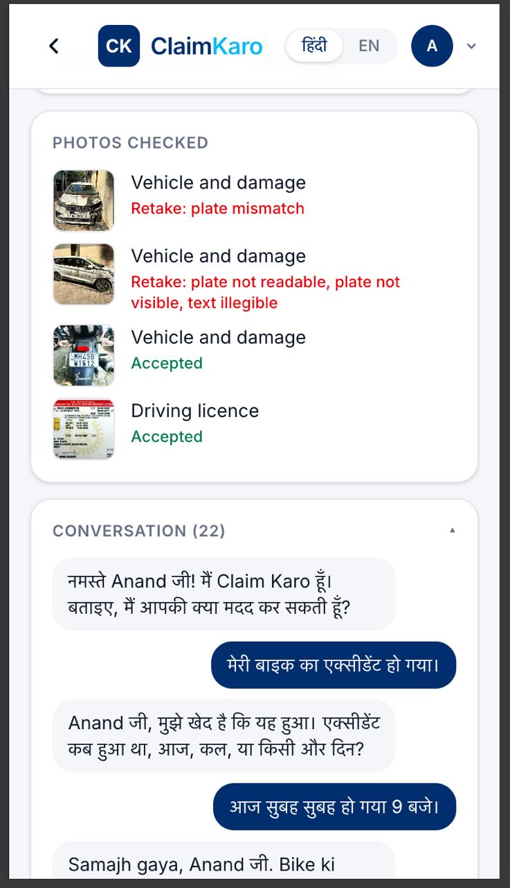
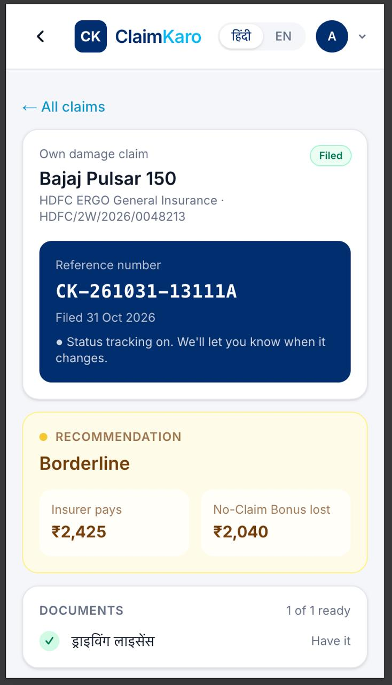
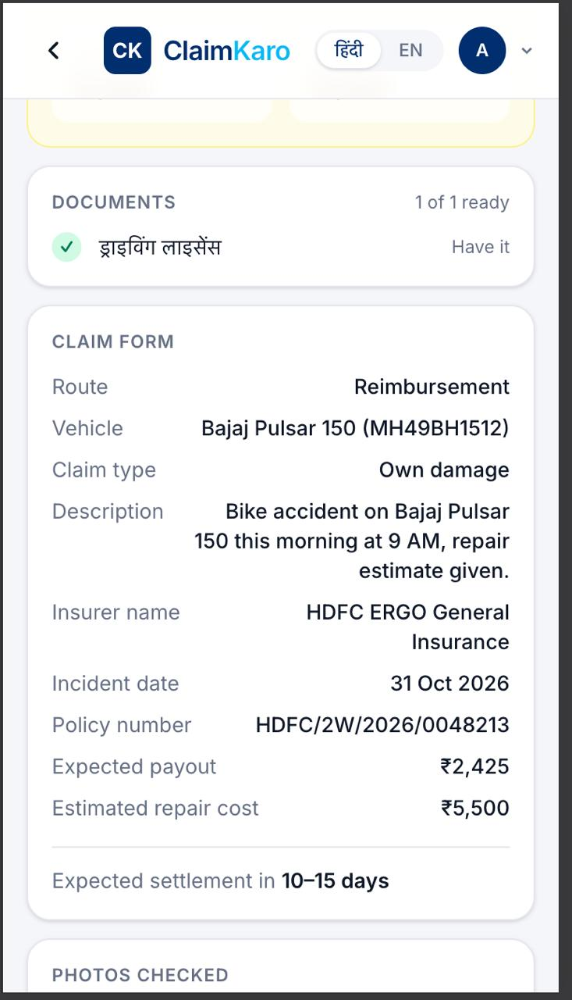

# Claim Karo — Motor Insurance Claims in Conversation

> Paytm "Build for India" AI Hackathon · Track 2: AI-Powered Financial Journeys
> Team: Claim Karo (2 people) · Build window: 4 days · Finals: 31 Oct 2026, Paytm Noida

This README is the single source of truth for scope, architecture and conventions.
Claude Code: read this fully before writing any code. If something here conflicts with
a later instruction in chat, the chat instruction wins, but update this file to match.

---

## Demo

**Working demo video:** [Watch on Google Drive](https://drive.google.com/file/d/1_nbMfDFoDgMDJGbSeqj0oiax0qretZ7D/view?usp=sharing)

## Screenshots

<p align="center">
  
  
  
</p>
<p align="center">
  
  
  
</p>

1. **Entry point** — the Insurance & Claims tile inside the Paytm home screen.
2. **Claim Karo home** — resume a filed claim or start a new one; policies from the wallet listed below.
3. **Hindi chat intake** — the assistant disambiguates the vehicle and incident date; a step bar tracks progress.
4. **Photo grading** — damage photos graded live, with plain-language retake reasons.
5. **Viability verdict** — insurer payout vs No-Claim Bonus lost, plus the filed reference number.
6. **Pre-filled claim form** — route, vehicle, insurer, expected payout and settlement estimate.

---

## 1. What we are building

A voice-first web app where a user describes a **motor** (two-wheeler or car) accident in
Hindi or English, uploads damage photos, and an AI agent:

1. Extracts a structured incident from the conversation.
2. Matches the applicable motor policy from the user's (synthetic) Paytm wallet.
3. Runs a **claim viability check** — deductible, No-Claim Bonus (NCB) loss, IDV cap,
   exclusions — and tells the user in plain language whether filing is worth it.
4. Grades uploaded damage photos against surveyor requirements and asks for retakes.
5. Pre-fills the claim form live on screen, lists missing documents.
6. Estimates settlement time.
7. Speaks every step back to the user via TTS in their language.

**Out of scope (do not build):** health/any non-motor insurance, real insurer APIs, real
Paytm data, login/auth, WhatsApp channel, full-duplex voice, mobile native apps,
post-filing follow-up agent (pitch only).

### The headline feature, explained

Every claim-free year earns the policyholder a discount on next year's own-damage (OD)
premium: 20% → 25% → 35% → 45% → 50%. Filing any OD claim resets it to 0%.

So for a ₹4,000 scrape with a ₹1,000 deductible and a 35% NCB on a ₹10,000 OD premium:

- Insurer pays: 4,000 − 1,000 = **₹3,000**
- NCB lost next year: 35% × 10,000 = **₹3,500** (plus the forfeited step-up in later years)

Net: the user is worse off by claiming. For a ₹38,000 collision the same math says claim.
The agent does this math (deterministically, in Python) and explains it (via Claude).
If the policy has an **NCB Protect** add-on, the verdict flips to "claim" for small claims.

---

## 2. Feature scope by priority

| Priority | Feature | Owner |
|---|---|---|
| P0 | Hands-free voice intake (LiveKit + Sarvam STT) + text fallback | B |
| P0 | Incident extraction to structured JSON (Claude, structured output) | A |
| P0 | Policy matching from synthetic wallet | A |
| P0 | Viability rules engine + Claude explanation in user's language | A |
| P0 | Photo upload + vision grading with retake guidance | A/B |
| P0 | Live claim-form panel that fills as fields arrive (LiveKit `claim.state`) | B |
| P0 | Missing-document checklist | A |
| P0 | Settlement estimate (lookup table) | A |
| P0 | TTS replies (Sarvam) with pre-generated audio for fixed lines | B |
| P1 | Own-damage vs third-party routing, FIR-needed logic | A |
| P1 | Consistency check: described impact vs photo damage vs garage estimate | A |
| P2 | Third-party damage demo journey | — |
| Pitch only | Post-filing SLA tracking, Ombudsman escalation, WhatsApp | — |

Do not start a P1 item until every P0 item works end to end in Scenario 1.

---

## 3. Architecture

```
┌──────────────────────────────── Browser (Next.js) ──────────────────────────────┐
│  Chat column                          │  Claim panel                            │
│  - bot/user bubbles (text always)     │  - form fields animate in as found      │
│  - hands-free talk (mic toggle)       │  - photo thumbnails with ✓ / retake     │
│  - photo upload                       │  - viability verdict card               │
│  - LiveKit plays the agent's voice    │  - missing docs, settlement estimate    │
└───────────────┬───────────────────────┴──────────────────────┬──────────────────┘
   POST /livekit/token (REST)  │  WebRTC room: mic audio, lk.chat text, "photo" bytes ⇄
                               │  agent audio, lk.transcription, "claim.state" snapshots
┌──────────────────────────────┴──── LiveKit server (Docker, :7880) ─────────────────┐
└──────────────────────────────┬─────────────────────────────────────────────────────┘
┌──────────────────────────────┴──── Voice agent (agent/claim_agent.py) ─────────────┐
│  AgentSession: Silero VAD + turn detector, Sarvam STT/TTS, Claude LLM + tools       │
│  tools → services/rules.py (money), db (Postgres); photos → claude.py (vision)      │
└──────────────────────────────────────────────────────────────────────────────────┘
┌──────────────────────────────── FastAPI backend (main.py) ───────────────────────┐
│  wallet lookup, dashboard, file-from-dashboard, LiveKit tokens                    │
│  db/  asyncpg, schema.sql (applied on startup)   data/  policies.json users.json  │
└──────────────────────────────────────────────────────────────────────────────────┘
        │ Claude API (text + vision)   │ Sarvam API (streaming STT + TTS)   │ Postgres (Docker)
                                                                        ▲ CloudBeaver :8978
```

### Design decisions (do not relitigate)

1. **A LiveKit voice agent whose tools enforce the steps.** LiveKit Agents runs the call
   (WebRTC audio, voice activity and turn detection, interruptions, typed chat). Claude
   leads the conversation, but every step goes through a tool (`record_incident`,
   `start_claim`, `decline_claim`, `file_claim`) that checks the current stage and refuses
   out-of-order calls; photos are graded outside the LLM; filing is gated in `db.file_claim`.
2. **Rules decide, Claude explains.** All money math lives in `services/rules.py` and is
   unit-tested. Claude receives the computed numbers and writes the explanation. Claude
   never computes deductibles, NCB or payouts.
3. **Policies are hand-written structured JSON**, not PDFs in a vector store.
4. **One model**: Claude (`CLAUDE_MODEL`) runs the conversation through the LiveKit
   Anthropic plugin at low effort, and grades photos with structured outputs
   (`client.messages.parse` with a Pydantic `output_format`; retry once on validation
   failure). Sonnet 5.5 rejects forced `tool_choice`, so tools are never forced.
5. **Language flow**: Sarvam STT auto-detects Hindi/English; the agent replies in the
   language the user last spoke or typed, and switches the TTS language to match.
6. **Transport**: **one LiveKit room per conversation.** `POST /livekit/token` creates the
   room and dispatches the `claim-karo` agent into it. Typed chat uses `lk.chat`, replies
   arrive as `lk.transcription`, photos as byte streams on `photo`, and the agent sends the
   whole claim as one JSON snapshot on `claim.state` after every change. Working state
   lives in the agent session and is written through to Postgres.
7. **Hands-free, no barge-in.** The mic is off until the user taps it; LiveKit decides when
   the user has finished. While the bot speaks, the mic audio is not transcribed: on laptop
   speakers the mic hears the bot, and that echo would otherwise interrupt it.
8. **Text is always visible.** Every bot utterance is rendered as text; voice is additive.
9. **Synthetic data only.** Nothing calls a real insurer or Paytm.

---

## 4. Agent state machine

```
INTAKE ──► MATCH_POLICY ──► VIABILITY ──► EVIDENCE ──► FORM_REVIEW ──► FILED
   ▲            │               │                                        
   └── ask ─────┘   (no policy) │ (user chooses not to claim) ──► ADVISED_NO_CLAIM
                    └──► NO_COVER
```

| State | Input | Does | Claude call | Tool / trigger | Next |
|---|---|---|---|---|---|
| `INTAKE` | user utterance | Extract/merge `Incident`. If required fields missing, ask one targeted question. | conversation LLM | `record_incident` | self (ask) or `MATCH_POLICY` |
| `MATCH_POLICY` | Incident | Filter user's policies by vehicle reg + date in period + cover type. A policy that had lapsed by the incident date gets the fixed `policy_expired` line. | none (rules) | inside `record_incident` | `VIABILITY` or `NO_COVER` |
| `VIABILITY` | Incident + Policy | `rules.viability()` → numbers + verdict. Claude explains in user language. Ask "claim karna hai?" | conversation LLM | `start_claim` / `decline_claim` | `EVIDENCE` (yes) / `ADVISED_NO_CLAIM` (no) |
| `EVIDENCE` | photo | `vision.grade_photo()` against checklist. Retake or accept. Loop until required shots present. | `grade_damage_photo` (vision) | `photo` byte stream | self or `FORM_REVIEW` |
| `FORM_REVIEW` | — | Assemble `ClaimForm`, compute missing docs, settlement estimate. Read summary aloud. | conversation LLM | after the last photo | `FILED` on user tap |
| `FILED` | user tap | Persist, show reference number. | none | `file_claim` | end |

Required `Incident` fields to leave `INTAKE`: `vehicle_ref` (or vehicle type if only one
in wallet), `incident_date`, `description`, `estimated_repair_cost_inr` (can be "unknown" →
agent asks for garage estimate or lets user say "pata nahi" and proceeds with
`VIABILITY` in "estimate pending" mode).

---

## 5. Data model

Stored in Postgres (`api/db/schema.sql`, tables listed in §11); Pydantic models in `models.py`. Synthetic seed data in `data/`.

```python
class User:           id, full_name, preferred_language ("hi"|"en"), phone_number
class Vehicle:
    id, user_id, vehicle_type ("2W"|"4W")
    vehicle_number                       # registration (number plate)
    brand, model, manufacture_year
class Policy:
    id, user_id, vehicle_id, insurer_name, policy_number
    coverage_type: "comprehensive" | "third_party_only"
    coverage_start_date, coverage_end_date
    insured_declared_value_inr: int      # IDV
    own_damage_premium_inr: int          # base for NCB math
    no_claim_bonus_pct: 0|20|25|35|45|50
    compulsory_deductible_inr: int       # 100 (2W) / 1000–2000 (4W) typical
    voluntary_deductible_inr: int
    add_on_covers: list["zero_dep"|"ncb_protect"|"engine_protect"|"rsa"|"consumables"]
    excluded_conditions: list[str]       # e.g. "drunk_driving","no_valid_dl","commercial_use"
    required_documents: list[str]        # e.g. "rc","dl","policy_copy","garage_estimate","fir"
    cashless_garage_names: list[str]
    driving_licence_number, driving_licence_holder_name, driving_licence_valid_until
                                         # DL given at policy issuance; the claim's DL upload must match
class Incident:
    id, session_id, user_id, vehicle_id
    incident_date, incident_location, description_english, description_user_language
    third_party_involved: bool, third_party_property_damaged: bool, anyone_injured: bool
    estimated_repair_cost_inr: int | None, garage_estimate_uploaded: bool
    police_report_filed: bool | None
    garage_name: str | None              # in policy.cashless_garage_names → cashless route
    risk_flags: list[str]                # "drunk_driving","no_valid_dl","commercial_use",
                                         # "theft","hit_and_run" — matched against exclusions / FIR rules
class Viability:
    insurer_payout_inr, deductible_inr, depreciation_inr,
    ncb_loss_year1_inr, ncb_loss_total_inr
    verdict: "claim" | "dont_claim" | "borderline" | "not_covered"
    reasons: list[str]                   # machine codes, e.g. "NCB_LOSS_EXCEEDS_PAYOUT"
    ncb_protected: bool
    estimate_pending: bool               # no damage estimate yet; numbers are zero
class Evidence:
    id, claim_id
    evidence_type ("damage_wide"|"damage_close"|"number_plate"|"odometer"|"garage_estimate"|"dl"|"rc")
    file_path, is_accepted: bool, quality_issues: list[str], ai_confidence_score: float
    extracted_details: dict              # number plate / DL fields read off the photo
    detail_mismatches: list[str]         # rules.verify_details: PLATE_MISMATCH, DL_NUMBER_MISMATCH, ...
                                         # any mismatch rejects the upload; filing needs a matching
                                         # vehicle photo and DL (db.file_claim refuses otherwise)
class Claim:
    id, incident_id, policy_id, claim_type ("own_damage"|"third_party"|"both")
    claim_status: "draft"|"filed", claim_form_data: dict
    documents: {document_code: is_provided}   # checklist, stored in claim_documents
    expected_settlement_days_min, expected_settlement_days_max, claim_reference_number
class Session:
    id, user_id, conversation_stage, conversation_language, history: list[dict], started_at
```

### Synthetic seed data

`api/data/users.json` (users + vehicles) and `api/data/policies.json`:

Three users, one per folder in `api/data/case1..3`, built from the DL, plate and damage
photos there so those images can be uploaded as test evidence. Every policy is comprehensive
and requires only the driving licence (`dl`).

| # | Policy | Vehicle | Key terms | Test images |
|---|---|---|---|---|
| 1 | `POL-BABU-2W` | Anand's Bajaj Pulsar 150 (2021), `MH49BH1512` | NCB 35%, OD premium ₹2,400, deductibles ₹100 + ₹500 voluntary, no add-ons | `case1`: DL, rear plate |
| 2 | `POL-BABU-4W` | Anand's Maruti Ertiga (2022), `HR52H9260` | NCB 20%, OD premium ₹15,500, deductible ₹1,000, `zero_dep`, `rsa` | `case1`: burnt Ertiga (the `23BH4589AZ` car is a wrong-vehicle test) |
| 3 | `POL-NADARAJAN-2W` | Nadarajan G's Yamaha MT-15 (2022), `TG153335` | NCB 25%, OD premium ₹2,800, deductible ₹100, `zero_dep` | `case2`: DL, MT-15 damage, detached plate |
| 4 | `POL-NADARAJAN-4W` | Nadarajan G's MG Hector (2021), `DL12TC0271` | NCB 50%, OD premium ₹18,000, deductible ₹1,000, `ncb_protect`, `rsa` | `case2`: Hector rear damage |
| 5 | `POL-SAHAYASAILA-2W` | Sahayasaila T's Bajaj Pulsar NS200 (2020), `TN12B5422` | NCB 45%, OD premium ₹2,600, deductible ₹100, no add-ons | `case3`: Pulsar damage (plate only partly readable) |
| 6 | `POL-SAHAYASAILA-4W` | Sahayasaila T's Maruti Swift Dzire (2015), `TN12C0455` | NCB 25%, OD premium ₹6,500, deductible ₹1,000, `rsa` | `case3`: DL, Dzire rear damage |
| 7 | `POL-SAHAYASAILA-SCOOTER` | Sahayasaila T's Honda Activa 6G (2019), `TN12AB7781` | **Expired** 30 Sep 2026 (the one lapsed-policy case): the bot says when it ended and to renew in Paytm, nothing else | none (never reaches photos) |

---

## 6. Rules engine (`services/rules.py`)

Pure functions, no I/O, 100% unit-tested. All amounts in integer INR.

```python
def match_policy(incident, policies) -> Policy | None
def claim_type(incident, policy) -> "own_damage"|"third_party"|"both"|None
def viability(incident, policy, vehicle, as_of=None) -> Viability
def is_cashless(incident, policy) -> bool
def missing_documents(incident, policy, evidence) -> list[str]
def required_photo_kinds(incident, vehicle) -> list[str]
```

`match_policy` returns a policy only if the vehicle matches, the incident date is in the
policy period, **and** `claim_type()` is not `None` (so own damage on a third-party-only
policy → `NO_COVER`).

Viability logic (v1):

```
assessed      = min(estimate, idv)
depreciation  = 0 if zero_dep in addons else assessed * depreciation_factor(vehicle age)
payout        = max(0, assessed - depreciation - compulsory_deductible - voluntary_deductible)
                (depreciation is applied before deductibles, as surveyors do)
ncb_loss_y1   = 0 if "ncb_protect" in addons else od_premium * ncb_pct / 100
ncb_loss_tot  = ncb_loss_y1 + forfeited step-up over next 2 years:
                  Σ (no-claim ladder − post-claim ladder) × od_premium for years 2 and 3
                  e.g. from 35%: years 2–3 are 45/50 without a claim vs 20/25 after one
verdict:
  not_covered   if exclusion hit or no applicable cover for the claim type
  dont_claim    if payout <= ncb_loss_tot
  borderline    if payout <= ncb_loss_tot * 1.25
  claim         otherwise
reasons: machine codes only; Claude turns them into language.
```

Depreciation (IRDAI standard, simplified to one blended factor by vehicle age, measured
from 1 Jan of the model year): 0–6m 0%, 6m–1y 5%, 1–2y 10%, 2–3y 15%, 3–4y 25%,
4–5y 35%, 5y+ 45%.

Settlement estimate (`data/settlement_table.json`, `services/settlement.py`): keyed by
`(claim_type, cashless|reimbursement, docs_complete: bool)` → `[min_days, max_days]`.

Documents: `policy_copy` and `rc` are auto-satisfied from the wallet. `garage_estimate`
is waived on the cashless route (the network garage submits it). Nothing else is added
from the incident: the user is only ever asked for what the policy lists (today, `dl`).

Required photos: `damage_wide` (must show the number plate) for every vehicle, plus `dl`
when the policy requires it. No odometer photo is asked for.

---

## 7. Claude calls (`services/claude.py`)

All calls use structured outputs: one Pydantic output model per function, effort `low`
for latency. System prompt is shared; each state passes a small task block.

| Function | Input | Output schema (abridged) |
|---|---|---|
| `extract_incident` | prior `Incident` JSON + new utterance + user vehicles | `Incident` fields (nullable) + `clarifying_question: str\|null` + `reply_to_user: str` |
| `explain_verdict` | `Viability` + policy summary + language | `reply_to_user: str` (in user language, ≤ 3 sentences, mention rupee numbers) |
| `grade_damage_photo` | image + `expected_kind` + checklist | `kind_detected`, `accepted: bool`, `issues: [codes]`, `retake_instruction: str`, `damage_observed: str` |
| `summarise_claim` | `ClaimForm` + missing docs + settlement | `reply_to_user: str` |
| `check_consistency` (P1) | incident description + damage_observed + estimate | `consistent: bool`, `flags: [str]`, `question_for_user: str\|null` |

Prompting rules:

- Claude must **never** invent policy numbers, amounts, or terms. All numbers come in via
  the tool input; the system prompt says so explicitly.
- `reply_to_user` must be in `session.language`; for `hi` use natural Hinglish-friendly
  Devanagari (the TTS handles Devanagari; avoid heavy Sanskritised Hindi).
- Keep replies short: the TTS reads them aloud.

Photo checklist for `grade_damage_photo` (surveyor requirements):

- `damage_wide`: whole vehicle visible, damage area in frame
- `damage_close`: damage fills ≥ 30% of frame, in focus
- `number_plate`: plate legible
- `odometer`: reading legible
- `garage_estimate`: document, itemised, total and date legible
- Generic issue codes: `BLURRY`, `TOO_DARK`, `PLATE_NOT_VISIBLE`, `DAMAGE_NOT_VISIBLE`,
  `TOO_FAR`, `TOO_CLOSE`, `WRONG_SUBJECT`, `TEXT_ILLEGIBLE`

---

## 8. Sarvam integration (LiveKit plugin `livekit-plugins-sarvam`)

- **STT**: streaming `saaras:v4` (`SARVAM_STT_MODEL`) with `language="unknown"`, so Hindi
  and English are auto-detected; the detected language steers the reply language.
- **TTS**: streaming `SARVAM_TTS_MODEL` (default `bulbul:v3`) with `SARVAM_TTS_SPEAKER`
  (default `shubh`, the male voice; plain `shubh` exists only on `bulbul:v3`);
  `target_language_code` follows the user (`hi-IN`/`en-IN`).

---

## 9. API contract

```
GET /users/lookup?phone=9000011111       login stand-in: wallet user + vehicles + policies
                                         (matches the last 10 digits; 404 if unknown)
GET  /users/{user_id}/dashboard          policies (with vehicle + required documents) and
                                         every claim conversation from its first message
                                         (most recently active first), each with its stage,
                                         resumable and deletable
GET  /users/{user_id}/claims/{session_id}       one claim: stage, verdict, photos, conversation;
                                                form + document checklist once it reached review
POST /users/{user_id}/claims/{session_id}/file  file a draft; {claim_reference_number}
                                                (409 if not at review yet, filed, or documents
                                                don't match)
DELETE /users/{user_id}/claims/{session_id}     delete a claim and its whole conversation
                                                (409 once filed)
POST /livekit/token?user_id=u_babu&language=hi[&session_id=…]
                                                {server_url, participant_token}: a new room with
                                                the claim-karo agent in it; with session_id the
                                                agent resumes that claim (state + chat history)
```

LiveKit room topics (one room = one conversation):

```
lk.chat          browser → agent   typed text (and the claim / don't-claim / file buttons)
lk.transcription agent → browser   what the user said and what the agent says
photo            browser → agent   byte stream; file name "<photo id>.jpg"
claim.state      agent → browser   JSON snapshot after every change:
                 {sessionId, state, fields, policy, viability, photos: {<id>: {status, evidence_type,
                  quality_issues}}, form, missingDocs, settlement, referenceNo}
```

---

## 10. Frontend (`web/`)

Next.js (App Router) + Tailwind v4. Single page with two views after login, the dashboard
and the claim conversation; two columns on desktop, stacked on mobile.

Paytm-inspired theme (navy `#002E6E`, cyan `#00BAF2`), tokens in `app/globals.css`.

- `components/Login.tsx` — mobile-number entry (+91), calls `/users/lookup`. Test numbers:
  9000011111 (Ravi, Hindi) and 9000022222 (Priya, English).
- `app/page.tsx` — header (My claims tab, language toggle, New claim, profile menu with log
  out on the avatar), then the dashboard (after login) or the conversation (new or resumed;
  a resumed claim shows its earlier messages above the live ones).
- `components/Dashboard.tsx` — claims grouped In progress / Filed / Closed, each with
  Continue (resume in chat) and Delete (until filed); the selected claim's details (verdict,
  document checklist, form, photos, conversation; File claim once at review), and the
  user's policies with the documents a claim on each needs.
- `components/Chat.tsx` — messages, tap-to-talk mic, text input, photo upload in
  `EVIDENCE` (resized to 1600px JPEG), claim / don't-claim buttons; the mic button turns hands-free talking on and off.
- `components/ClaimPanel.tsx` — progress stepper, verdict card, the user's vehicles and
  policies (until one is matched), incident fields, policy, verdict card, photo grid with
  ✓ / retake, claim form, missing docs, settlement, File claim button.
- `lib/useClaim.ts` — the LiveKit session's messages, agent state, mic, photo upload and the
  latest `claim.state` snapshot, as one `ClaimState`.

Never block the UI on audio; text appears first.

---

## 11. Repo structure

```
claim-karo/
├── README.md                   ← this file
├── docker-compose.yml          # Postgres 17 + CloudBeaver + LiveKit server
├── docker/cloudbeaver/         # preset CloudBeaver connection (copied in on first run)
├── start.ps1 / stop.ps1        # start / stop everything
├── api/
│   ├── main.py                 # FastAPI app + LiveKit token endpoint
│   ├── db/                     # __init__.py (asyncpg queries), schema.sql
│   ├── agent/claim_agent.py    # LiveKit voice agent: tools, photo grading, state
│   ├── services/               # claude.py rules.py settlement.py
│   ├── models.py               # Pydantic
│   ├── seed.py                 # loads data/*.json into models
│   ├── data/                   # users.json policies.json settlement_table.json
│   ├── static/audio/           # pre-generated TTS
│   ├── scripts/pregen_audio.py
│   └── tests/test_rules.py
├── web/                        # Next.js app
│   ├── app/                    # layout.tsx page.tsx globals.css
│   ├── components/             # Chat.tsx ClaimPanel.tsx Dashboard.tsx Login.tsx
│   └── lib/                    # useClaim.ts api.ts format.ts media.ts
└── docs/
    ├── DEMO_SCENARIOS.md
    └── pitch/Claim_Karo_Pitch.pptx
```

Env vars (`api/.env`): `ANTHROPIC_API_KEY`, `SARVAM_API_KEY`, `CLAUDE_MODEL`,
`SARVAM_STT_MODEL`, `SARVAM_TTS_MODEL`, `SARVAM_TTS_SPEAKER`, `DATABASE_URL`,
`LIVEKIT_URL` / `LIVEKIT_API_KEY` / `LIVEKIT_API_SECRET` (dev server: `ws://localhost:7880`,
`devkey`, `secret`), `CORS_ORIGINS` (optional). Web (`web/.env.local`, optional):
`NEXT_PUBLIC_API_URL` (default `http://localhost:8000`).

### Running locally

Needs Docker Desktop, Python 3.13 (`py` launcher) and Node 22.

```
.\start.ps1            # Docker, empty the database, frontend production build, then API, agent and web
                       # (next start) in their own windows; the API recreates the tables and reseeds
.\start.ps1 -KeepData  # same, but keep sessions and claims from earlier runs
.\stop.ps1             # stop everything (data stays until the next .\start.ps1)
.\stop.ps1 -Reset      # stop everything and delete the database + CloudBeaver volumes
```

The first run creates `api/.venv`, `api/.env` and `web/node_modules`.

| Service | URL | Login |
|---|---|---|
| App | http://localhost:3000 | — |
| API | http://localhost:8000 | — |
| LiveKit | ws://localhost:7880 (agent worker: `python -m agent.claim_agent dev` in `api/`) | `devkey` / `secret` |
| CloudBeaver | http://localhost:8978 | opens anonymously with the `Claim Karo (Postgres)` connection; admin `cbadmin` / `ClaimKaro123` |
| Postgres | `localhost:5433`, db `claim_karo` | `claimkaro` / `claimkaro` |

Tables: `users`, `vehicles`, `policies`, `policy_required_documents`, `documents`
(catalog with English/Hindi names) — all copied from `data/*.json` on every start —
`sessions`, `messages`, `incidents` (with verdict + viability JSON), `evidence`, `claims`,
`claim_documents` (each claim's document checklist).
All credentials are local-dev only.

### Running the backend tests

```
cd api
py -3.13 -m venv .venv          # or python3.11+ -m venv .venv
.venv/Scripts/pip install -r requirements.txt     # .venv/bin/pip on macOS/Linux
.venv/Scripts/python -m pytest
```

---

## 12. Demo scenarios (build exactly these)

**Scenario 1 — Two-wheeler scrape, Hindi, advise not to claim**
User (Anand): "Signal pe bike ko taxi ne maar diya, ₹4,200 ka kharcha bata raha hai
mechanic."
→ policy 1 matched → ₹4,200 − 45% depreciation (₹1,890) − ₹600 deductibles = payout
**₹1,710**; NCB loss ₹840 next year, **₹2,040** over three years → `dont_claim`
→ agent explains in Hindi and recommends paying out of pocket; offers to file anyway.

**Scenario 2 — Car rear-ended, English, claim worth filing**
User (Nadarajan G): "Someone hit the back of my Hector, garage says ₹38,000."
→ policy 4 (`ncb_protect`) → ₹38,000 − 45% depreciation (₹17,100) − ₹1,000 = payout
**₹19,900** vs NCB loss ₹0 → `claim`
→ EVIDENCE: `case2` Hector photo (plate `DL12TC0271`) → `case2` DL
→ form pre-filled → File → reference number.

**Scenario 3 (P2) — Third-party damage**: user hit someone else's car; agent routes to
third-party cover, says FIR is required, explains own-damage portion separately.

Record a screen + audio video of Scenarios 1 and 2 on Day 4 as a fallback.

---

## 13. 4-day plan

| Day | Person A (backend / agent) | Person B (frontend / voice) |
|---|---|---|
| 1 | Seed data; `models.py`; `rules.py` + tests; settlement table | Next.js skeleton; `MicButton` recording; Sarvam STT/TTS wrappers against a stub; `pregen_audio.py` |
| 2 | `state_machine.py` INTAKE → VIABILITY; `claude.py` extract + explain; WebSocket | `useClaimSocket` reducer; `ClaimPanel` fields animating; audio queue |
| 3 | EVIDENCE + vision grading; FORM_REVIEW; missing docs | Photo upload + `EvidenceGrid`; integration; Scenario 1 end to end |
| 4 | Scenario 2 end to end; P1 if time; latency tuning | Polish, error states, rehearsal, fallback recordings |

Definition of done for Day 3: Scenario 1 runs start to finish on a fresh session with
voice in and voice out, no console errors.

---

## 14. Risks and mitigations

| Risk | Mitigation |
|---|---|
| Hindi STT misses rupee amounts / dates | Show transcript, let user correct by text; Claude extraction tolerates Hinglish numerals |
| Vision grading inconsistent | Low temperature; strict issue-code enum; accept on second attempt if confidence ≥ 0.6; manual "accept anyway" button hidden behind long-press for demo emergencies |
| Claude invents amounts | Numbers only via tool input; Pydantic validation; unit test that explanation contains the exact rupee figures passed in |
| Latency > 4 s per turn | Pre-generated audio; sentence-level TTS; show fields streaming before the reply; Sonnet not Opus |
| Venue Wi-Fi / API outage | Local fallback recordings; text fallback; cached TTS for both scenarios |
| Scope creep | Anything not in Section 2 P0 waits until Scenario 1 is done |

---

## 15. Conventions

- Python 3.11+, `ruff` formatting, type hints everywhere, Pydantic v2.
- No business logic in `main.py`; it calls the agent graph; graph nodes call services.
- Every Claude tool has a fixture test with a canned response.
- Commit small and often; `main` must always run Scenario 1.
- Log every Claude/Sarvam call with latency to `logs/` — we will tune from this.
